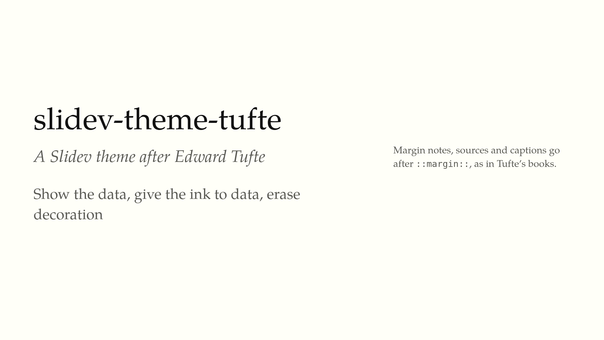
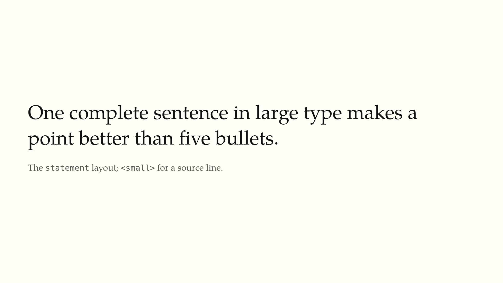
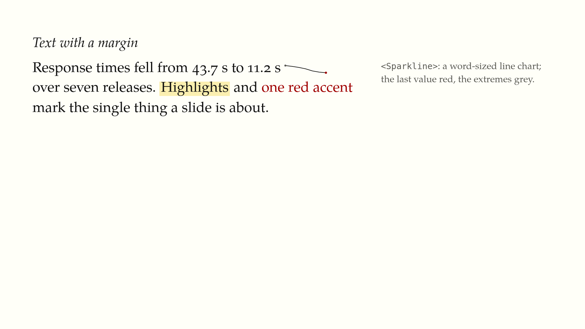
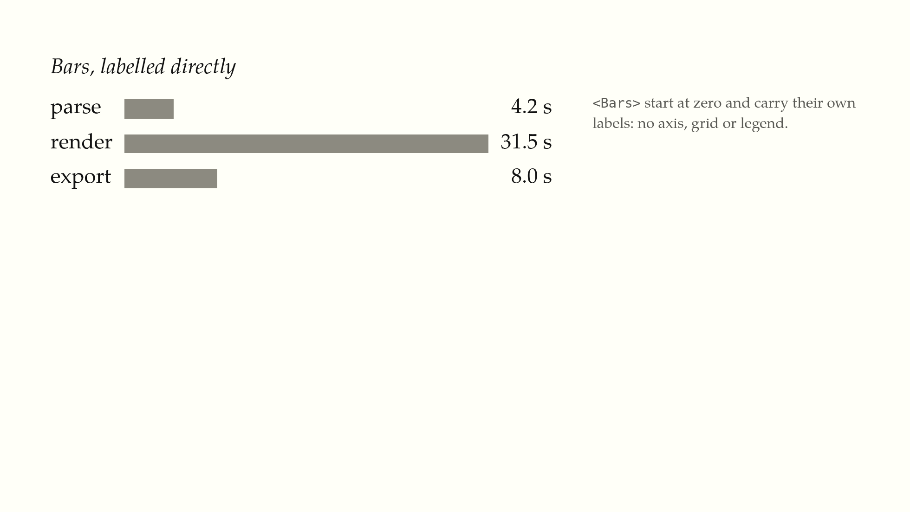
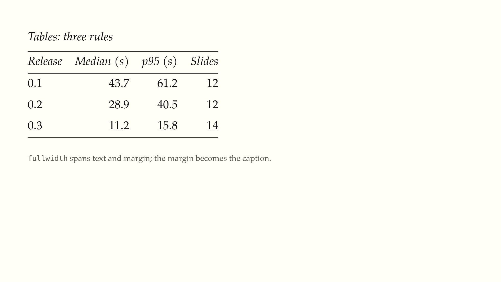
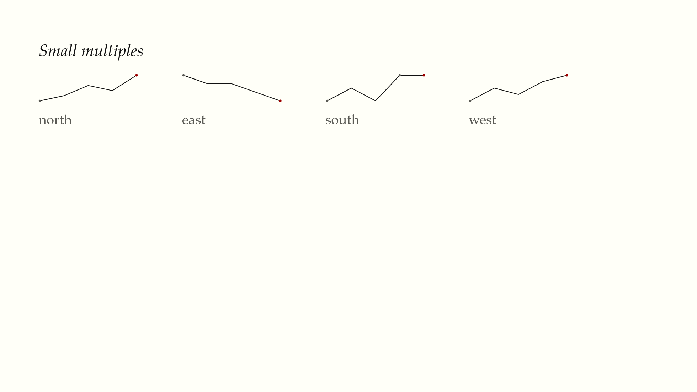
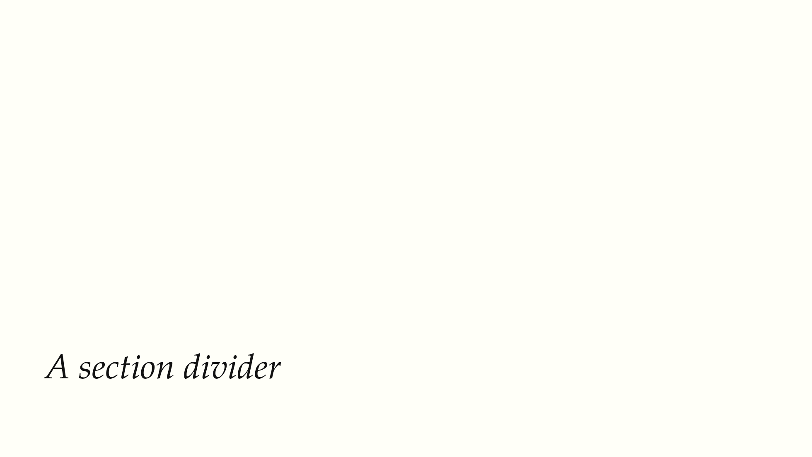
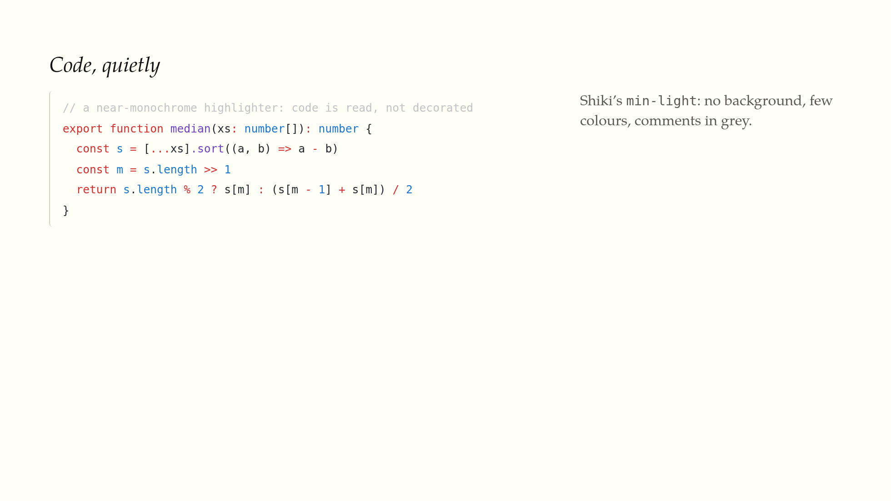
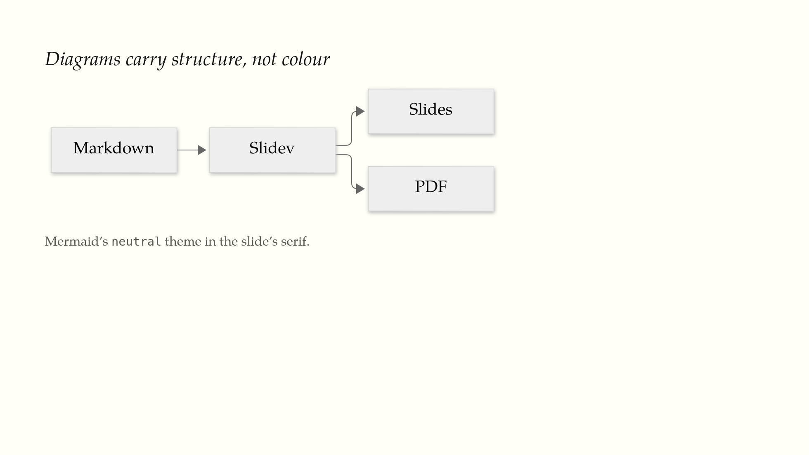

# slidev-theme-tufte

[](https://www.npmjs.com/package/slidev-theme-tufte)

This is a theme for [Slidev](https://sli.dev) that follows the ideas Edward Tufte set out in *The Visual Display of Quantitative Information* and his later books. It tries to get out of the way of your content: the slides are set on warm off-white paper in a single serif typeface, there is a margin column for notes and sources like in Tufte's own books, and there is no decoration that does not help the reader understand something.

If you mostly present numbers, arguments and evidence rather than stock photos, this theme is meant for you.

## Install

Add the theme to the headmatter of your `slides.md`:

```yaml
---
theme: tufte
---
```

When you start Slidev, it will offer to install the theme for you. You can also install it yourself:

```bash
npm install slidev-theme-tufte
```

The theme requires Slidev 52 or later. The Slidev documentation explains [how themes work](https://sli.dev/guide/theme-addon#use-theme) in more detail.

## Screenshots

These are the slides of [`example.md`](example.md), which also serves as a quick tour of everything the theme can do.











## The ideas behind it

Tufte's central argument is simple: a slide, a chart or a page exists to show evidence, and everything on it that does not carry evidence competes for the reader's attention. Most presentation software does the opposite and adds frames, gradients, logos and animations by default. This theme tries to make the Tufte way the default instead, so that a deck written in plain Markdown already looks calm and readable.

### Show the data

The content gets the whole slide. There are no logos, footers, page numbers, progress bars or background images, and slide transitions are switched off. If something moves on screen, it should be because the data changed, not because the software wanted to show off.

### Spend the ink on data

Tufte measures a graphic by its *data-ink ratio*: how much of the ink actually represents data. The theme removes the rest wherever it can. Tables are drawn with just three horizontal rules, one above the header, one below it and one at the bottom, with no vertical lines, grids or striped rows. Code blocks get a thin line on the left instead of a box with a coloured background. The bar chart component draws bars and labels and nothing else, so there is no axis, no gridlines and no legend.

### No chartjunk

Shadows, gradients, 3-D effects and colour used for its own sake make a chart harder to read, not easier. Mermaid diagrams are therefore rendered in Mermaid's `neutral` theme, in greys and in the same serif as the text, and code is highlighted with Shiki's restrained `min-light` theme.

### Colour means something

The whole palette is dark ink on warm paper, plus a single red. That red is meant for the one thing a slide is about, such as the latest value in a sparkline or the number you want the audience to remember. Because it is the only colour, it stands out wherever you use it.

### Be honest about scale

The bars in `<Bars>` always start at zero, so the length of a bar is proportional to its value. Tufte calls this keeping the *lie factor* at one. If you show several bar charts side by side, you can give them the same `max`, and they will share one scale so the comparison stays fair.

### Label things where they are

Names and values are written right next to the marks they belong to. The reader should not have to look back and forth between a chart and a legend to work out what a colour means.

### Put words and graphics together

Tufte invented the *sparkline*, a small chart about the size of a word that sits directly inside a sentence. With `<Sparkline>` you can write "response times fell from 43.7 s to 11.2 s" and put the trend itself right after the numbers, so the reader sees the shape of the change while reading about it.

### Small multiples

When you want to compare many cases, Tufte recommends drawing the same small chart once for each case, with the same design and the same scale, and placing them next to each other. The eye can then compare them at a glance. The `multiples` class arranges such a grid for you.

### Write sentences, not bullet points

In *The Cognitive Style of PowerPoint*, Tufte argues that bullet outlines chop reasoning into fragments and hide how the points relate to each other. The `statement` layout is meant as an alternative: one complete sentence in large type that makes a point on its own. Lists still work, but they are styled quietly with an en dash and little indentation, so they do not dominate the slide.

### Use the margin

Tufte's books put sidenotes, sources and captions in a wide outer margin, right next to the text they refer to, instead of collecting them in footnotes at the end. Any slide in this theme gets such a margin column as soon as you add a `::margin::` section.

### Set the type for reading

All text is set in [TeX Gyre Pagella](https://www.gust.org.pl/projects/e-foundry/tex-gyre/pagella), a free version of Palatino that comes close to the typefaces in Tufte's books. Numbers in running text use old-style figures, which blend into the text, while numbers in tables use lining, equal-width figures so that the columns line up. Headings are not bold, and the text column is limited to about 65 characters per line, which is a comfortable length for reading.

## Usage

### Layouts

The theme comes with five layouts:

| Layout | What it is for |
|---|---|
| `default` | Normal slides with a text column. Add `::margin::` to get a margin column for notes, sources and captions. |
| `cover` | The title slide, made of typography only: title, italic subtitle and an author line, with an optional margin. |
| `statement` | A single complete sentence in large type, as an alternative to a bullet list. Use `<small>` for a source line. |
| `section` | A divider between parts of a talk, with a large italic title at the bottom left. |
| `fullwidth` | Wide figures, diagrams, tables and small multiples. Here the `::margin::` text is placed below the content as a caption. |

Slidev's built-in layouts, such as `center`, `quote` or `two-cols`, keep working and pick up the theme's typography.

#### Cover

```markdown
---
theme: tufte
layout: cover
---

# Response times in 2026

What changed, release by release

Christoph Martel · November 2026

::margin::

Data: production logs, January to October.
```

The first paragraph after the title becomes the italic subtitle, and everything after it is set in grey.

#### Text with a margin

```markdown
## Response times fell by three quarters

Median response time fell from 43.7 s to 11.2 s <Sparkline :values="[43.7, 40.1, 35.2, 28.9, 19.4, 14.0, 11.2]" />
over seven releases, mostly thanks to the new <span class="accent">render cache</span>.

::margin::

Medians of 1,200 requests per release. Source: production logs.
```

If you leave out `::margin::`, the slide has a single column at a comfortable reading width.

#### Statement

```markdown
---
layout: statement
---

Most of the time went into rendering, not parsing.

<small>Profiler traces, release 0.3</small>
```

#### Full width with a caption

```markdown
---
layout: fullwidth
---

## Releases

| Release | Median (s) | p95 (s) |
|---|---:|---:|
| 0.1 | 43.7 | 61.2 |
| 0.3 | 11.2 | 15.8 |

::margin::

Right-aligned columns (`---:`) line up because tables use equal-width figures.
```

#### Section

```markdown
---
layout: section
---

# Results

You can add an optional line underneath, which is set in grey.
```

### Components

#### `<Sparkline>`

A small line chart meant to be used inside a sentence. It scales to the range of its own values, marks the last value in red and the minimum and maximum in grey.

```markdown
Sales rose <Sparkline :values="[3, 5, 4, 8, 7, 9]" /> all year.
```

| Prop | Default | Description |
|---|---|---|
| `values` | required | The data series, as an array of numbers. |
| `width` | `72` | Width in pixels. |
| `height` | `16` | Height in pixels, which is about one line of text. |
| `extremes` | `true` | Whether to mark the minimum and maximum. |

#### `<Bars>`

A horizontal bar chart. The bars start at zero and are labelled directly, without an axis, a grid or a legend.

```markdown
<Bars :data="[{ label: 'parse', value: 4.2 }, { label: 'render', value: 31.5 }]" unit=" s" />
```

| Prop | Default | Description |
|---|---|---|
| `data` | required | The bars, as an array of `{ label, value }` objects. |
| `max` | the largest value | The value that fills the full width. Give several charts the same `max` so they share one scale. |
| `unit` | `''` | Text appended to each value, for example `" s"` or `"%"`. |
| `decimals` | `1` | How many decimals to show. |

### Classes and elements

A few classes and HTML elements have their own styling:

| | What it does |
|---|---|
| `<div class="multiples">` | Arranges its children in a grid for small multiples, three columns by default. Use `style="--cols: 4"` for a different number. |
| `<span class="accent">` | Sets text in the theme's red, for the one thing a slide is about. |
| `<mark>` | Highlights text with a pale yellow background. |
| `<small>` | Sets secondary text, such as sources or labels, smaller and in grey. |
| `> quote` | Sets quotations in italics and indents them, without a box or a bar. |

#### Small multiples

```html
<div class="multiples" style="--cols: 4">
  <div><Sparkline :values="[3, 4, 6, 5, 8]" :width="140" :height="40" /><br><small>north</small></div>
  <div><Sparkline :values="[6, 5, 5, 4, 3]" :width="140" :height="40" /><br><small>east</small></div>
  <div><Sparkline :values="[2, 3, 2, 4, 4]" :width="140" :height="40" /><br><small>south</small></div>
  <div><Sparkline :values="[5, 7, 6, 8, 9]" :width="140" :height="40" /><br><small>west</small></div>
</div>
```

### Code and diagrams

You do not need to configure anything for code or diagrams. Fenced code blocks are highlighted with Shiki's `min-light` theme and set in DejaVu Sans Mono, and ` ```mermaid ` blocks are drawn in Mermaid's `neutral` theme using the slide's serif.

### Defaults

The theme sets the following Slidev options. You can override any of them in your own headmatter:

```yaml
colorSchema: light
aspectRatio: 16/9
canvasWidth: 980
transition: none
fonts:
  sans: TeX Gyre Pagella
  serif: TeX Gyre Pagella
  mono: DejaVu Sans Mono
  provider: none
```

There is no dark mode. The slides are meant to look like printed paper.

## Palette

| Token | Value | Used for |
|---|---|---|
| `--paper` | `#fffff8` | the warm off-white background |
| `--ink` | `#111` | text and data |
| `--muted` | `#5a5a55` | margin notes, captions and other secondary text |
| `--rule` | `#111` | the rules in tables |
| `--hairline` | `#d6d3c4` | the thin line next to code blocks |
| `--accent` | `#a00000` | the single red |
| `--mark` | `#fbefb0` | the `<mark>` highlight |

The colours are defined as CSS variables on `:root` in [`styles/tufte.css`](styles/tufte.css). If you want to change one, put a `style.css` next to your slides and redefine it there:

```css
:root { --accent: #1f5fa8; }
```

## Fonts

The theme does not load any web fonts, so your slides look the same whether you are online or offline and when you export them to PDF. This means the fonts have to be installed on the computer you present or export from:

- [TeX Gyre Pagella](https://www.gust.org.pl/projects/e-foundry/tex-gyre/pagella) for text
- [DejaVu Sans Mono](https://dejavu-fonts.github.io/) for code

```bash
pacman -S tex-gyre-fonts ttf-dejavu      # Arch
apt install tex-gyre fonts-dejavu        # Debian, Ubuntu
brew install --cask font-tex-gyre-pagella font-dejavu   # macOS
```

Both fonts also come with TeX Live. If they are missing, the theme falls back to ETBembo, Palatino or Georgia, whichever is available.

## Further reading

- Edward Tufte, *The Visual Display of Quantitative Information* (1983, 2nd edition 2001)
- Edward Tufte, *Envisioning Information* (1990)
- Edward Tufte, *Beautiful Evidence* (2006), which introduces sparklines and discusses how to combine words and images
- Edward Tufte, *The Cognitive Style of PowerPoint* (2003)
- [tufte-css](https://edwardtufte.github.io/tufte-css/), which applies the same ideas to web pages

## Contributing

To work on the theme, run `npm install` and then `npm run dev`. This opens `example.md` in the browser, and any changes you make to it or to `styles/tufte.css` show up immediately.

`npm run export` creates `example.pdf`, and `npm run screenshot` regenerates the PNG files in `screenshots/`. Both need Playwright's Chromium, which you can install with `npx playwright install chromium`. If you would rather use a browser that is already on your system, pass its path, for example `npm run screenshot -- --executable-path /usr/bin/chromium`.

## Releasing

1. Bump the version with `npm version patch` (or `minor` or `major`). This also creates a commit and a tag.
2. Run `npm pack --dry-run` to check what goes into the package. It should only contain `components`, `layouts`, `setup`, `styles`, the README and the license.
3. Push with `git push --follow-tags`. npmjs.com loads the screenshots in this README from the GitHub repository, so they need to be there.
4. Publish with `npm publish`. You need to run `npm login` once beforehand.

## Credits and legal

This theme is an independent project. It is not affiliated with, endorsed by or sponsored by Edward Tufte or Graphics Press; his name only describes the design ideas the theme follows.

The paper and ink colours (`#fffff8`, `#111`) and the Palatino fallback fonts are the same as in [tufte-css](https://github.com/edwardtufte/tufte-css) by Dave Liepmann and contributors (MIT license), which was the main inspiration. No code from tufte-css is included.

The theme does not include any third-party code or fonts. It refers to the following by name only, and they are installed and licensed separately:

- [Slidev](https://github.com/slidevjs/slidev), MIT license, which also provides [Shiki](https://github.com/shikijs/shiki) (MIT) with its `min-light` theme and [Mermaid](https://github.com/mermaid-js/mermaid) (MIT)
- [TeX Gyre Pagella](https://www.gust.org.pl/projects/e-foundry/tex-gyre/pagella), GUST Font License
- [DejaVu fonts](https://dejavu-fonts.github.io/License.html), Bitstream Vera license with public domain changes

## License

MIT © Christoph Martel. See [LICENSE](LICENSE).
